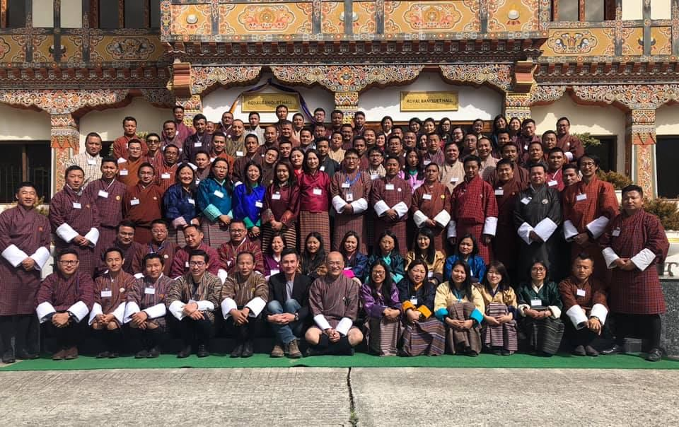

3-4 Mar 2019: YPLP Alumni Refresher Course

## **The Spirit of RIGSS Alumni**

Any alumni of [RIGSS](https://rigss.bt/) are expected to lead change through self development and to nudge others to change through their own spheres of influence. Alumni of RIGSS are given the permission to hold each other accountable to the personal developmental goals they have set for themselves. They are also expected to collaborate with each other to catalyse organisational development, even if they have to work across organisational silos. 

## **Change is Hard**

Nonetheless, change is hard work at any level. Just because one happens to attend a leadership course doesn’t make change any easier to achieve. And just because one has experienced crucible developmental moments during the course does not mean that the metamorphosis is complete. Not at all. 

For this reason, entry to a RIGSS course is competitive. This helps filter out those who seek to become a RIGSS alumni but are not open to development or are not willing to put in the hard work of continuing the change effort long after graduation.

## **Change Continues**

For any RIGSS alumni, the crucible moments experienced at RIGSS is assurance that one can change for the better. For some, this is already a great hope for the future, because many alumni return to workplaces in dire need of hope that good change can occur.

With proper [self-examination](https://adriansays.com/reflect-journal/) of how one’s own crucible moments came about, one can learn to replicate these moments in others. It is a two-step process - continue to improve as an individual and start to inspire improvement in others. Without the former to fuel the latter, RIGSS alumni will find it hard to be agents of change.

## **Refreshers are Crucial**

This is why it is important for alumni to receive refreshers. Alumni must come together to remember those crucible moments. They need to rouse themselves from daily defeats and recommit to the greater cause. They need to be reminded of the hope that they experienced for themselves and rehearse the skills needed to ignite the same in others. In other words, they need to be good to themselves so that they can be good to others. 

## **Count Your Days**

At the refresher, alumni are reminded that with each passing day, the fires of determination to stay true and faithful to the greater cause can become dimmer. It is important therefore to count our days, so that we can pace our way. For when we forget to count our days, we effectively forget to make our days count. 

Alumni must never forget that each day, the clock ticks towards the time when goodwill towards RIGSS ends. The only thing that will add more time to the clock is when alumni to do good to others. By the same token, all it takes is for one errant alumnus to do bad, and the draw down of goodwill will be complete in no time.

## **Not be Elitist**

RIGSS alumni must aspire towards elite standards but must never become elitist. It is the spirit of RIGSS to aspire towards excellence and to demand excellence from others. This spirit of excellence will set one apart, but it must never cause one to become elitist. 

To be elitist is to exclude others from the good one has received. And what is this good that RIGSS alumni receive? Alumni should not harp on any perceived material benefit or social capital. Those who chase after these things are not worthy. 

Instead, the only good that alumni should value is the opportunity to be found worthy to contribute to a greater cause. Any worthy good that a nation needs is seldom achieved quickly. Alumni must weather managerial upheavals, endure the vagaries of political winds, and stay untainted. They must learn to work in thankless anonymity, resist self-serving shortsightedness, and stay focused. It is a lonely task, for true alumni are few and far between.

## **Spread the Alumni Spirit to those yet to attend a RIGSS course**

Therefore, alumni must always welcome those who put others before self. Those that desire to drink from your communal cup of sacrifice must never be turned away. Though the cup may be bitter, it is better shared. Hence, never deny those who seek to savour the taste of fellowship of a community aspiring to be better versions of themselves. In other words, even if not alumni by participation in a RIGSS course, so long as they are of the same spirit, such people must be welcome.

## **Finite Time for Infinite Good**

Each of us has only a finite amount of time in which to do an infinite amount of good. How much good we do is just as important as the attitude behind each good we do. In this, "*becoming is better than being*", to quote Professor of Psychology at Stanford, [Carol Dweck](https://en.wikipedia.org/wiki/Carol_Dweck). No one can determine how much time we have. But we can be determined to keep becoming better, and to keep making others around us better.
