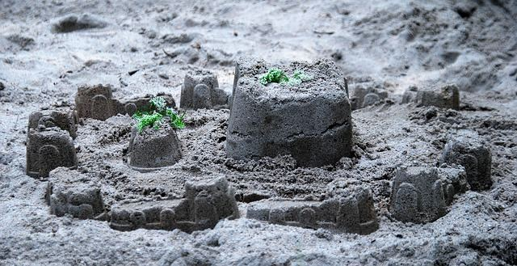
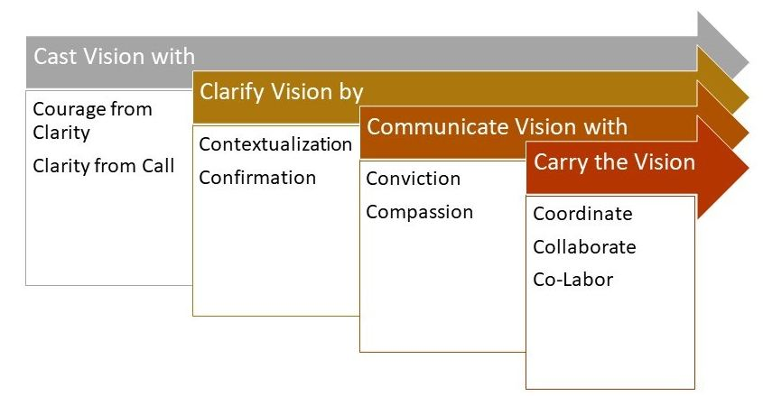

## **Change for Large Organizations is Painful**

How does one change a large organization, especially when such organizations are typically hierarchical, generally tribal, and often disparately autonomous amongst its component parts? Such organizations are loose collections of smaller affiliations with only marginal loyalties to a perceived central set of core ideals, values and leadership.

In large organizations, different parts within them are variously equipped for change. Each bit part has its separate appetite for change. Each comes with its own history and understanding of the relevance for change, such that the narrative that resonates within one may not necessarily be applicable to another. Even when some parts of the organization are convinced and ready for change, they are constrained by unique pre-existing work and circumstances such that the pace of implementation will certainly differ amongst them.

Change for large organizations is not impossible - just tremendously costly. The draconian force of compliance required to arm twist an entire organization into change within a set span of time can create monsters out of leaders and compel the organization into neurasthenia. And when the leadership who demanded the change is gone, things often revert to their original resting stage. Sullen and sullied by the effort, even good change that did occur unravels. Eventually, nothing endures, and only burnout and cynicism remains.

## **Change as a Community of Sandboxes**

The only way to change a large organization is to reframe the organization as a community of [sandboxes](https://upwardsleader.com/2016/10/24/how-to-lead-with-a-sandbox-culture/comment-page-1/), each with its own rules for play, pace of play, and place to play.

How does one know the right way to splice an organization into the relevant sandboxes? This question alone determines the quality of leadership, for if leaders are to shepherd their flock, they must know their sheep intimately. If leaders do not recognize the correct sandboxes to configure, then we have a more basic problem to address – that of leadership. In which case, organizational change can wait until personal change has delivered the goods.

4Cs of Change through Sandboxing

## **The 4 Cs of Change through Sandboxing: Cast-Clarify-Communicate-Carry**

Once sandboxes are configured within the organization, this is where the fun begins. Top leaders must visualize the change and cast a vision for change. After that, it is up to each sandbox to clarify the vision, to communicate the vision to all players within the sandbox, and for each player within the sandbox to carry the vision to fruition. In carrying the vision, there is coordination, collaboration, and co-laboring. In communicating the vision, there is conviction and compassion in equal measure. In clarifying the vision there must be confirmation and contextualization. And finally, in casting the vision, there must be a clear call and courage that comes from that clarity. Each step in the procedure requires careful coaching and caring coaxing. Not every leader can do all these from the onset. But every leader must be able to step up eventually.

## **The First Sandbox Conveys Hope**

The first successful sandbox conveys hope. The first sandbox is a learning entity who enjoys experimenting. This sandbox has the highest levels of a growth mindset, grit and reflection, over and above the usual action-orientation, energy and innovation. This first sandbox says that it is okay to experiment, occasionally fail, but to always learn. By the time this sandbox is done, the first fruits of the labor are not just the attained change objectives, but also an alumnus who knows how to learn. Thereafter, each of these alumni can then be ingrafted into other sandboxes to promote the same learning mindsets while allowing their adoptive hosts to chart out their own paths of change.

## **The Second Sandbox Conveys Faith**

If the first successful sandbox conveys hope, then the second sandbox must convey faith. The second sandbox is determined to learn just as the first sandbox did, but in its own way. The second sandbox, in having to chart its own path, must not to be swayed by fears of deviating from the path embarked by the first. If the first did it one way, the second must be comfortable with having to find its own way. The only encouragement that the alumni of the first sandbox has to offer is that an attitude of learning is the key. By this, the second sandbox experiences its own success, thereby proclaiming that there are ways to successful change that do not lead to the land of the dead, and that the obol needed for one to pass from death to life is the currency that comes from a learning mindset.

## **Change IS a Community of Sandboxes**

By the time an organization celebrates two successful yet different sandboxes, it is well on its way to enacting its own story of transformation. By then, the organization would have acquired more than just the new changes. More importantly, it would have acquired a new ability and appetite for change.

Leaders who gift their organizations with this transformation are the ones whose legacies will be remembered with gratitude. Such leaders can move on to different arenas, confident of the organizations they leave behind, assured of their own abilities to enact change for good wherever they are called.

For more about effecting change through the use of sandboxes, refer to a previous article I have written [here](https://adriansays.com/effective-change-sandbox/).
