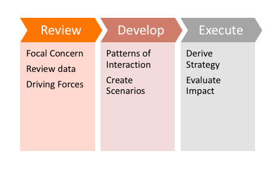
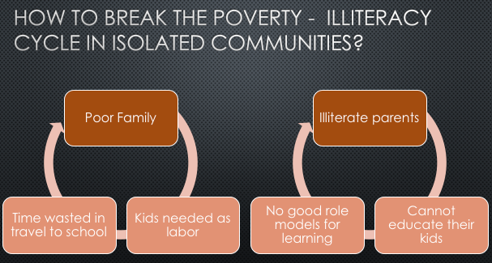
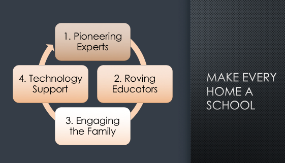
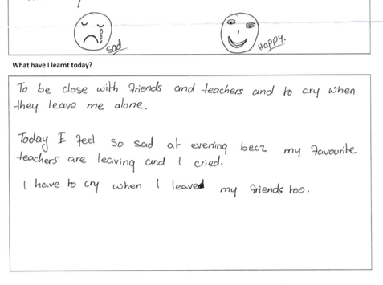
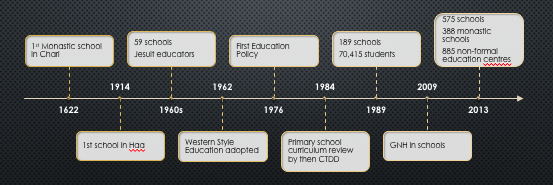
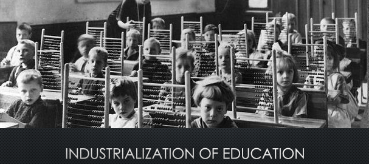
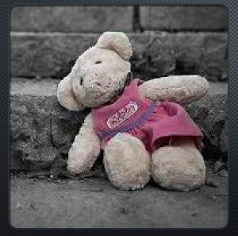

*What should one consider with regard to the future of education in Bhutan? This is an adaptation of a presentation entitled "The Future of Education" which I delivered at the 2017 Sherig Conference in Panbang, Bhutan to educators in Bhutan. To retain the feel of a speech, I have kept the salutations and exhortation at the end. However, the content and flow of the presentation has been updated to be more aligned with the Scenario Planning Process. As a result, this version is quite different from the original presentation I made at the Sherig Conference. I hope this revised presentation adds something new to those who heard the original presentation at the Sherig Conference. All opinions shared in this article are solely my own. If I have misrepresented any perspectives, do forgive me and please let me know.*

# **Salutations**

Bhutan is blessed with an emphasis on education that comes from the highest authority in the land. The very fact that all of you are here today is testament to this emphasis, and to your passion for your vocation. You have committed to this week-long conference to recharge, reflect and re-strategise the way ahead for the future of education in Bhutan. As a fellow educator, please accept my sincere thanks for your commitment and sacrifice to this vocation.

# **The Mindset Needed to Rethink Education**

To rethink education is to hold oneself accountable to our future generation in how one ought to act in the present, while at the same time give credit to the efforts of those who have gone before us. In that sense, all educators must commit to rethinking education at all times. Whether as new teacher, an experienced educator, or as support staff, we are all responsible to rethink education. Rethinking education is also a highly personal endeavour. How one educates others can differ from one's colleague. This is only natural. One must tailor education to the needs of the students. We ought to give it the best, most creative expression within our sphere of influence. One must be committed to being a reflective educator. How else then can one inspire reflective learners? This reflective mindset will compel us to rethink education while going through the activities of one's day as an educator. It will also compel us to allocate special periods like this week to think more deeply on the future of education.

# **Scenario Planning: Use of Driving Forces to Help Rethink Education**

Aside from having the right mindset to help us rethink education, we also need the right sort of tools to help us analyse the past and frame the various possible futures of education in Bhutan. The Scenario Planning Process is a good way (though it is not the only way) to guide us through our deliberations.  Overview of the Scenario Planning Process This entire week has been filled with soul-searching dialogue. In this presentation, I hope to add to this dialogue. By drawing from Scenario Planning Methodology, I propose 2 Driving Forces for us to consider as we rethink education in Bhutan.

## **Driving Force \#1: The Impact of Internal Connectivity**

As a chilip\[note\]Foreigner\[/note\] looking from the outside in, I find Bhutan fascinating. For a country roughly the size of Switzerland, Bhutan boasts 25 languages \[note\]Lewis, M. P. (2009). Ethnologue: Languages of the world (16th ed.). Dallas: SIL International.\[/note\] (and this is not counting the dialects). It seems like many communities in Bhutan are isolated from the rest by virtue of the mountains and seasonal road conditions. In spite of continued investments to improve road connectivity, and in spite of technological advances which allow communities to be electronically connected to each other, many parts of Bhutan remain relatively isolated from each other. I believe there is a psychological element to this. Having lived here for just under 2 years, I have come to appreciate the peace and reflective pauses created by being up in the mountains, alone and unplugged from the Internet and from social media. There is just something about the solitude of the mountains that puts things into perspective.

### Impact of Driving Force \#1 on Poverty and Education

On the other hand, the tranquility of isolation can be soporific and can hamper interaction and development. In the latest Bhutan Poverty Analysis Report\[note\]Bhutan Poverty Analysis Report 2017\[/note\], poverty is unevenly distributed between the rural countryside and urban centres of Bhutan. For every 1 person classified as poor in the urban areas, there are 12 poor people in the rural areas. More worrying is the impact that poverty has on education. In the same report, 99% of the poor (whether from rural or urban areas) stop studies at secondary school levels. On reflection, one can understand why poverty, particularly in the rural areas, has devastating effects on education. For the poor in rural areas, it takes longer to walk to and from school. I hear that students in some rural areas walk more than 4 hours daily just to get to and from school. After school, they have to help out in the farms and at home, leaving little to no time for their own studies. 4 hours of walking each day gives one a lot of time to ponder if education is really worth the trouble.  The Poverty-Illiteracy Cycle in Isolated Communities

### Impact of Driving Force \#1 on How Education is Defined

The mountains and the physical connectivity of Bhutan do create challenges on how to bring education to the rural communities. Each community is different. Each may have its own views on what education is and what types of education is appropriate. The farmers in the wetlands have intimate knowledge about how to farm. This is education they need to pass on to their young. The highlanders have intimate knowledge of the mountain trails and of herding. They maintain the border relationships with Bhutan's neighbours. This is their unique knowledge to pass on to their young. Contrast this with the standardised education that is offered to their children - there is often a disconnect between the unique knowledge to be passed down in order to retain community vitality versus what formal schooling offer.

#### What a Shepherd Has to Say

In his book "The Shepherd's Life", James Rebanks writes\[note\]The Shepherd's Life:Modern Dispatches from an Ancient Landscape, Flatiron books.\[/note\]:

*"I realised we were different, really different, on a rainy morning in 1987. I was in an assembly at the 1960s shoddy built concrete comprehensive school in our local town. I was thirteen or so years old. Sitting surrounded by a mass of other academic non-achievers listening to an old battle-weary teacher lecturing us on how we should aim to be more than just farmers, workers, joiners, brickies, electricians and hairdressers.*

*We were basically sorted aged twelve between those deemed intelligent (who were sent to a "grammar school") and those that weren't (who stayed at the "comprehensive"). Her words flowed past us without registering, a sermon she'd delivered many times before. it was a waste of time and she knew it. We were firmly set, like our fathers and grandfathers, mothers and grandmothers before us, on being what we were, and had always been. Plenty of us were bright enough, but we had no intention of displaying it in school. It would have been dangerous."*

Here is a shepherd from the famous Lake District in England who is obviously bright. He writes well and has published books. He is hugely determined to define for himself what his own education ought to be like. Eventually, he received formal education at Oxford University. It enhanced the self-education he had already embarked on, allowing him to clarify how to maintain the traditional ways that were so precious to his community. I wish there were more like him who is proud of his heritage, assured about what being bright means, and clear about what he needs to do to maintain his identity.

#### What Each Community Has to Say

Bhutan's own rural communities need to define what education ought to be like for themselves. Like the teacher in the passage above, it can be hard to encourage some communities in Bhutan to send their children to school. Take for example, the communities involved with the seasonal harvest of cordyceps. It is good money and one only has to work really hard during the harvest season. As a worker, it does not matter whether one is educated or not. As long as one is willing to put in effort during the harvest months, there will be profit at the end of the season. For the children who witness this disconnect between formal education and money, they can easily become unconvinced about the benefits of formal education, especially if it means sending much needed workers away to school during harvest season. In time to come, they may even become parents who in turn do not emphasise providing formal education to their children, thereby perpetuating a vicious cycle.

### **A Couple of Plausible Scenarios**

In Scenario Planning, one first identifies the driving forces and the patterns of interaction. The next step is to derive plausible scenarios that address the issues identified. With my sincerest apologies to my fellow Scenario Planning practitioners, I am going to shortcut what is typically months of sifting through data, clarifying assumptions, and robust deliberations. For the purpose of making this presentation more complete, I will move on to create pose a couple of plausible scenarios for my audience here.

#### Scenario 1: Make Every Home a School

Instead of viewing the poor network connectivity between rural areas of Bhutan as a disadvantage, one can look at the close-knit communities in these isolated areas both as a ready-made advantage and as a necessity to maintain. It is an advantage because communities are essential for education. Even the best of formal educational institutions are founded on strong communities of learning, communities of practice and the alumni. Why tear up communities by deporting their children to schools far away when there is a ready-made community available to leverage on for education? It is necessary to sustain these communities and keep them intact. This is not just for the sake of these communities, but also for the sake of Bhutan itself. Why do I say so? Bhutan is more than just Thimphu or Phuentsholing, or any of the urban centres. Bhutan is still largely rural, and mostly agrarian. In the interest of its food security, it needs to balance the pull of migration to urban centers (and to centralised schools for its students) versus rural development (and allowing students to be educated in rural settings). Every centralised school with full boarding for its rural students robs its rural communities of the much needed labour to maintain agricultural activities. In the long run, fertile farmland will become fallow from disuse, or outsourced to foreigners. How then can we bring education to rural communities without committing all its young ones to centralised schools far from home? After all, is not farming and learning to live with the land also a form of education that we should maintain? Is not upholding one's agrarian heritage a distinct advantage in a world that is increasingly food-stressed? It is ironic that we hold farming with such disdain here in Bhutan. In places like Switzerland, busy office workers would take time out from their schedules so that they can pay to stay and work in farms. If the erosion of love for farming is left unchecked, it can be dangerous for Bhutan. Over time, Bhutan will have no choice but to abandon the fruit of the land and become a workforce for some industrial factory in another country. We must recognise that failure to cultivate a love for the land is an educational failing. As an parent with 2 children who are homeschooled, I firmly believe that we must begin education from home. Formal education should augment what we are teaching at home, not the other way round. Every home is a school and must learn to become one. As parents, we define what is education that comes from home. When we can do that, we can determine what is formal education that we ought to get from schools. Even then, whatever goes on in school is still our responsibility as the primary educator for our children. We do not adopt an outsourcing mentality when it comes to education.

#### A Vision Where Every Home is a School

Imagine a typical farming village in which its children are learning to be farmers and receiving formal education at the same time. Imagine these children not having to walk far to attend school. Instead, school comes to them in the form of online education, augmented by regular check-ins from visiting teachers. These children spend time farming, helping with household chores, and engaging in play. They take charge of their own formal education. They decide for themselves what they want to study. Through their mobile phones, they enrol in online education for credits pre-approved by the national accreditation board in Bhutan. A team of highly experienced educators regularly drop in to check on these children. The children welcome them warmly. Each of these visits result in the children receiving feedback on their education. The educators focus on imparting insights on how to learn, rather than what to learn. During such visits, the educators counsel the children on their career choices. They co-opt the parents into the discussion about the aspirations of the children. The adults talk about better ways of supervising, motivating, rewarding and disciplining. They discuss how to help children negotiate the various trials of growing up, such as avoiding the pitfalls of sexual experimentation, joining unruly gangs and engaging in unhealthy relationships. After each visit to the communities, the educators reflect on the experience. For them, each of these visits are mini-sabbaticals. They derive insights on emerging educational trends, pedagogy, content and curriculum. They learn to partner with parents, and make use of emerging technologies. Before resuming their routine duties, they report to an educational research centre to consolidate these findings. In this way, they harvest their findings for their own professional development while also contribute to invigorating the educational ecosystem. Meanwhile, the children are left on their own until the next visit. They take charge of their own study time. The older children supervise the younger ones, providing peer tutoring and encouragement. Because Bhutan already boasts more than 90% mobile penetration\[note\]92% of Bhutanese own a mobile phone according to the 2017 Annual ICT Report, http://www.moic.gov.bt/wp-content/uploads/2017/08/DITT.pdf\[/note\], they can call in to a hotline where a team of educators answer any topic that these children pose, be it a math problem or a relationship concern such as whether one should go out with someone.  Each of the above statements are not pipe dreams. The ideas are drawn from various educational experiments around the world\[note\]The ideas come from the Israeli Kibbutz, the homeschooling practices of heartland America, the self-directed curriculum of modern online education and the emerging emphasis of holistic education espoused by countries such as Singapore.\[/note\]. Bhutan does not need to make its own mistakes. It can make informed choices based on the experiences of others. A particular mistake to avoid is raising a generation of Bhutanese who do not know their own roots. Another mistake to avoid is to lose one's national identity as an agrarian nation. This is highly disconcerting when one's king has seen fit to keep 70% of the land green, and when precious wetland remain a royal gift available to those willing to work it.

#### Scenario 2: Make Every School a Home

In Singapore, we have a saying: "It takes a kampong\[note\]Village\[/note\] to raise a child." I believe the same is true here. I have noticed that many of your toppers in the annual exams are from rural areas. This is reassuring. It means that one does not need to be from urban schools to do well in national exams. Schools from rural areas will also have its fair share of outstanding students. In my visits to schools and through conversations with educators, I have come to appreciate what makes a good school. One of the things that stand out for me are educators who create a nurturing environment. These educators go out of the way to make their schools a safe harbour, a home away from home. I hear of students from abusive families who would much rather spend their holidays in school than to go home. I also hear touching testimonials of students. Many students feel an eternal debt of gratitude to teachers who have stepped up to become the parents they never had. In selecting students for the inaugural intake of Royal Academy, I had students draw people who have significantly influenced them in their lives. Many of them draw pictures of teachers.  Written reflection by a student about his sadness because his teacher is leaving.

### Tweak the Strategy

Presently, Bhutan is centralising schools. The aim is to pool together resources to make these schools the best equipped for formal education. To alleviate the need for students to travel far to and from home, many central schools have boarding facilities. I think the logic behind pooling resources is sound. However, we need to recognise that this is a necessary evil rather than a desired good. I am neutral towards the central school system, because every solution has its limitations and no solution is ever perfect. We just need to negate the pitfalls. More thought and research needs to go into where central schools have done well and why. We need to better understand where central schools have created more downside than upside. It is simplistic to promise equity (e.g. one central school in each region) when one is gunning for optimisation.

### Not a One-Size-Fits-All

Each central school is unique and will require customisation. For instance, a school in a rural area can serve as a community hub for the region. What it needs to sustain its additional role as a community hub may be different than anticipated. It may need more money for a communal library, agricultural research, and even different procurement processes for daily feeding programs. In contrast, a central school in an urban centre may implement the concept of a central school quite differently. For example, not all students in urban areas will take up full boarding even if the school offers it. This then compels the school to go into mixed boarding mode instead. If the school is located in a well-to-do region, it may not need to offer amenities such as free uniforms to all its students. All in all, each central school ought to derive its own recipe for educational success. We ought to review this data more closely. There is no strategy that is perfect; a good strategy is one that manages the unintended consequences well. Centralisation of schools can introduce the downside of efficiency, which is the industrialisation of education. It will be a horrible day when we depersonalise formal education in the name of efficiency. Already, we run schools like we run factories. In the face of overwhelming workload, we often forget how to celebrate and nurture individuals to their full potential.  

## **Driving Force \#2: The Historical Impact of the Western Educational System**

Western education in Bhutan is less than 50 years old. Alongside the benefits that it has brought, Bhutan has also encountered its less desirable pitfalls.  Western Education in Bhutan is less than 50 years old

### Pitfall \#1: Industrialisation of Education

In the history of education, we have failed to educate ourselves on the lessons from history. Historically, the current, industrialised mode of education began with the Industrial Age. The driving need then was for a workforce able to work machines in factories. There was no need to individualise standards to the potential of each individual. Instead, there was a need to standardise individuals, regardless of their potential. Clearly, we have moved on from these needs. Today, we seek to grow each child to his or her full potential. Yet, our educational systems have not kept pace with our aspirations. It has remained strangely archaic and firmly rooted in its industrial underpinnings. There is a divine irony I find in all of this. Bhutan, being a Third World country, lacks the necessary resources to implement a full-blown industrialised approach to education. Yet Bhutan produces world class thinkers and philosophers, religious leaders and outstanding individuals. Bhutan, for a nation small in size, consistently punches above its weight when it comes to producing individual talents. Could it be that it is precisely our inability to fully implement a full blown industrialised educational approach which is allowing creativity and greatness to emerge? The more I see the ills of an industrialised approach to education, the more I am inclined to think so. 

### Pitfall \#2: Earlier Education at the Expense of Childhood

In Thimphu, I am finding parents who put children to school at an earlier age. This is not only expensive, but actually counterproductive to the developmental needs of the child. Education is not the only need of a growing child. There are other needs, such as values acquisition, learning how to make friends and manage one's own emotions, learning about right and wrong, learning how to learn from mistakes, learning to read and learning to learn by reading, all of which while can arguably\[note\]I say so because it is a rare school environment which takes time from its curriculum to pursue these things. More commonly found is the outstanding educator who takes especial effort to focus on these aspects of education as the opportunity arises. \[/note\] be learnt at school, must first be learnt from home. More crucially, early entry to schools place a strain and a mismatch on the educational system. For every year earlier we put a child into formal school, the cost of education increases exponentially. This is true not only for the parents, but for the system as a whole. Young children need good parents more than they do teachers. Yet we find in many early childhood centres teachers who are themselves young or soon-to-be parents. Some of these young teachers do step up and become great for the children. Many who do step up find that they draw more from their experience managing siblings at home than from formal education received from schools. Some parents argue that they have no time for parenting. They say that by adopting a dual-income lifestyle, they can afford better educators. I say when children are very young, the best educators they can get for their children are themselves as parents. More importantly, learning to be a parent is not something one can outsource. Children who grow up without a good childhood and nurturing parents are more likely to become maladjusted adults later in life\[note\]See for example, a meta-analysis conducted by Leschied, Alan & Chiodo, Debbie. (2008). Childhood Predictors of Adult Criminality: A Meta-Analysis Drawn from the Prospective Longitudinal Literature. Canadian Journal of Criminology and Criminal Justice - CAN J CRIMINOL CRIM JUSTICE. 50. 10.1353/ccj.0.0027.\[/note\], which incur greater social and material cost to fix. Excessive early education simply makes poor sense.  Loss of Childhood can undo all the benefits of education

### Pitfall \#3: Focus on Certification and Knowledge, Not Learning

Recently, I heard a story from a friend who was attending the graduation ceremony at RUB. He heard a student go up to receive his graduation certificate, return to his seat and then declare, "Congratulations! I am now officially unemployed." Many Bhutanese today work hard to graduate from school with the expectation that they should find jobs waiting for them. The correlation between getting a degree and getting a job is getting weaker with each day. This is because the essential skills needed to land a job do not necessarily come with the degree. Some of the best paying jobs in Bhutan are skills-based which do not require a degree. A good Bhutanese plumber or an electrician can earn enough to live comfortably. Yet Bhutanese youths voluntarily taking up such vocations are as rare as the Red Panda.  The Race for Certificates The sad truth about certificates is that it is a stamp that one has acquired outdated knowledge. Not enough mainstream colleges offer key skills that are in demand today, such as blockchain technology and big data analysis. These colleges take too long to respond to market forces. By the time they make necessary curriculum adjustments, they are already behind the curve. Conversely, there are enduring skills that will always be in demand. Schools do not emphasise enough skills such as leadership, critical thinking, and learning how to learn. They should be core subjects! Instead, schools cram students with knowledge that are easily retrieved from the palm of their hands. No wonder the correlation between graduating with a certificate and finding a job is getting poorer by the day!

### Pitfall \#4: Toppers Versus the Rest

When I first came to Bhutan, I came to know of the word "Topper". It refers to the list of mugshots published proudly in schools and in the national newspapers featuring students who have emerged top in the national exams. These toppers expect any hiring organisation to snap them up. I often wonder if these toppers quickly grow a sense of entitlement. I also wonder what happens to the remaining 99% of each graduating class. Do the "Non-Toppers" feel marginalised? Do the hiring organisations value them less? What does that do to the climate and culture at the workplace? The mindless pursuit for ranking and ratings has more downside than upside. The upside is that for a system managing many people, it identifies a select few to pay more attention to. The downside is that invariably, we tend to treat everyone else who is not a topper as if they are dross.  Albert Einstein - World Famous Non-Topper Albert Einstein, Leonardo Da Vinci, Walt Disney, Richard Branson, Tom Cruise...these are all famous people. Yet none of them were toppers in their academic days. In fact, all of them were dyslexic. In today's educational system,  they will suffer because of their learning difficulties. Bhutan is a small country of less than 800,000 people. Hence, we ought to celebrate and nurture every individual to their full potential. Either one expands the criteria for toppers to include every human discipline or make the criteria ipsative\[note\]In ipsative assessment, learners are assessed based on one's previous work rather than on performance against external criteria and standards. Learners work towards a personal best rather than always competing against others. \[/note\], preferably both. In other words, one ought to be the best in a discipline of one's own choosing. At the same time, we should aspire to attain our best given our respective gifting.

# **The Future of Education for a Brave New World**

The inertia generated by 50 years of Western education is inexorable. While it has accelerated education to the masses, it has also created some downsides. We need to discuss how to manage these downsides. My guess is that we need to creatively destroy and courageously dismantle. Since this is such a drastic endeavour, some form of sandboxing\[note\]I am in the process of writing a separate paper written about the concept of Policy Sandboxing. \[/note\] may be needed to experiment with what ought to be dismantled, what ought to be replaced, and what what ought to be re-envisioned. It is a new world for Bhutan as it graduates from Least Developed Nation status into Developing Nation status. To prepare for this brave new world, it is timely to consider the future of education in Bhutan.  

# FOOTNOTES
