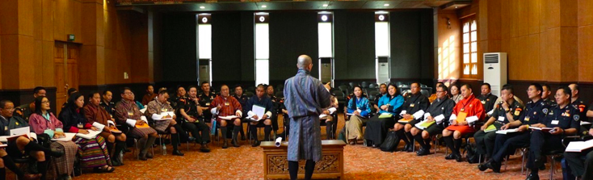
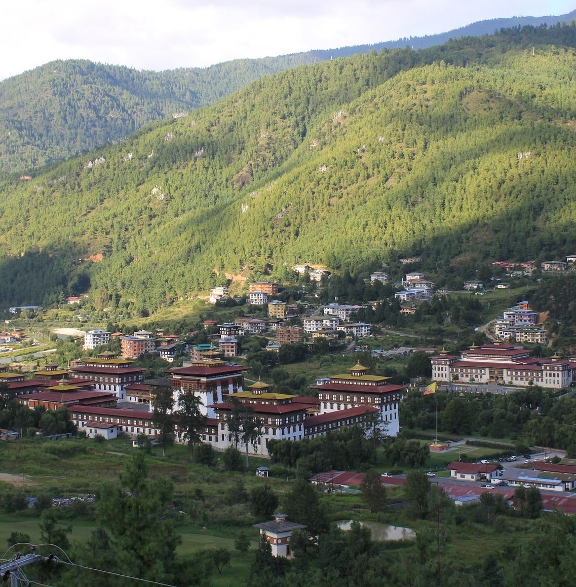

# MY WORK

 Adrian teaching leaders in Bhutan the steps for more effective reflective practices

##### How I develop leaders and grow organisations? As a psychologist with a focus on learning, I have been incorporating this interest into my professional and personal practice.

##### For instance, my PhD [dissertation](https://digitalcommons.unl.edu/cgi/viewcontent.cgi?article=1010&context=businessdiss) examined how different types of reflection can hamper or hasten leadership development of soldiers. I found that ruminative thinking lowers one's self efficacy towards leadership. It also leads to poorer development of one's ideas around leadership. In order to help leaders reflect better, I proposed several attributes of reflective thinking essential for more wholistic leadership development. I now incorporate these ideas into how I teach reflection and journaling. You can find these articles here:

\[pt_view id="a76c05534i"\]

------------------------------------------------------------------------

# COACHING

In my coaching practice, I help clients to reflect and learn from their own experiences. Most good coaches will help you do this and I am no different. The value add I offer is that I augment my coaching with the science I know around learning, reflecting and leadership development. I have conducted hundreds of coaching sessions to date. Typically, I try to steer clear of coaching jargon popularised by many coaching certification programs. Instead, I distil these jargon into its essential actionable steps, because I am a firm practitioner of regular, deliberate practice. Regardless of whether my coachee is a minister or a member of royalty, or a young adult starting out in his or her career, I treat each session as if it is the last session I will have with the person. It is not a bad mindset to have, because I do want to 'graduate' each coachee. At the same time, it also helps me focus on what is most essential to allow each coachee to move on.

------------------------------------------------------------------------

# CONSULTING

As an organisational development consultant, I work with a team of collaborators. Our aim is to help organisations become more effective managerially. Much of what we do entails helping organisations to learn better.As the lead consultant, I typically journey with these organisations by playing the role of an in-house resource person. In this capacity, I may coach individuals and teams. Alternatively, I may help collect input and data for analysis. Working with in-house teams, I may design training interventions. Or I may embed myself in meetings to help improve how the proceedings are conducted. It all depends on what are the needs of organisations at any particular point in time. "Being in but not of an organisation" pretty much sums up how I try to be helpful.

------------------------------------------------------------------------

# LEADERSHIP RESOURCE PERSON, KINGDOM OF BHUTAN

One of the most exciting assignments that demonstrated the way I work has been the developmental work in Bhutan. Since 2013, I serve as the Leadership Resource Person in the King's Office to help the kingdom bring about a national talent development pipeline. After months of consultation and groundwork, on 10 Oct 2013, the Royal Institute of Governance and Strategic Studies (RIGSS) was inaugurated. I became its first and only resident faculty from Oct 2015 to Oct 2018. The 3 years living in Bhutan has been personally and professionally enriching. It has allowed me undivided attention to help stabilise the throughput of the Institute's talent development programs. I was able to provide onsite support to its alumni in their personal development. By being available, I have been made part of the alumni's change efforts in their respective workplaces. It has been most satisfying to see real change happening in the lives and workplaces of the leaders in Bhutan. My time in Bhutan has helped me evolve my practice to better develop leaders and grow organisations.

------------------------------------------------------------------------

# RESEARCH

While pursuing my PhD, I was heavily involved in research. I thoroughly enjoyed the research process. There is a rigour to good research process that enlightens the way one views the world. Of course, being able to publish something at the end of a research cycle is an added bonus!Sadly, I am hardly involved in research these days. At least not in the way academics pursue it. To be doing research like academics, one should ideally be part of a university. Unfortunately, that option will pull me away too much from witnessing truth in action in the real world. It would also oblige me to participate in the 'publish or perish' rat race. The opportunity cost of being part of the race is too high for me. What do I mean?

------------------------------------------------------------------------

# De-Emphasising Publications

As a researcher, I am learning to loosen the preoccupation with publishing in academic journals. Instead, I am focusing more on transferring insights into action. Having been involved in the publication process during my PhD days, I have come to realise that by the time top-tier journals publish their articles, the "cutting edge" knowledge being expounded upon is already several years old. Because researchers are focused on bringing their ideas to publication, there is a costly delay in translating useful insights into real world applications. Having experienced this personally, I try to reduce the delay from insight to application. By being less pre-occupied with the publication process, I hope to be more relevant to real world realities and applications in how I approach research. Another reason why I de-emphasise publication has to do with the platform itself. I am concerned that the cost and ease of access to academic journals is set too high for non-academics, and that journals are slowly losing their impact as vehicles for conveying knowledge to the masses. One has to subscribe to or pay to read articles. Next, one has to work through the technical language that seems to be de rigueur for inclusion in these journals. Finally, because the academic focus of these articles are on research rigour, practical suggestions for applying insights seem an afterthought in the minds of the writers. It is left to reflective readers to flesh out for themselves the scanty suggestions for applications provided.

------------------------------------------------------------------------

# Emphasising Application and Insights from Praxis

To me, research is literally "Re-search." It is the rediscovery of old wisdom. What do I mean? In the field of leadership, organisational development and learning, there are not many insights that are truly new. There are, however, novel applications to put into practice. If we shift our focus from publication to practice, there is much we can rediscover, recapture and put to new use in and around us. Having said this, it is not that academic rigour should be thrown out of the window altogether. Instead, there should be a better balance of allowing insights to emerge from praxis rather than overly focusing on bringing a particular insight into publication at the expense of the former. Consequently, given the work that I am involved in at this point in my life, the most research I can engage in is as a "pracademic" - someone who combines academic or research interests with an active practice. I try to bring the academic rigour of research into the practice I provide to my clients. I also try to ensure that I take time to harvest and aggregate insights from my practice. Eventually, I hope to contribute more academically to my area of interest by publishing these insights. Meanwhile, in case you are interested, here is a sample of the refereed publications and book chapters I contributed to during my PhD days:

------------------------------------------------------------------------

### ***REFEREED PUBLICATIONS***

Hannah, S. ,  Avolio, B. J. ,  Chan, A. , &  Walumbwa, F. (2012). Leader self and means efficacy: A multi-component approach. Organizational Behavior and Human Decision Processes, 118, 143-161. Avolio, B. J., Reichard, R. J., Hannah, S. T., Walumbwa, F. O., & Chan, A. (2009). A meta-analytic review of leadership impact research: Experimental and quasi-experimental studies. *The Leadership Quarterly, 20*(5), 764-784. Avolio, B., R. J. Reichard, R. J., Hannah, S. T., Walumbwa, F. O., & Chan, A. (2005). 100 year review of leadership intervention research: Briefings report 2004-01. *Leadership Review*, Gallup Leadership Institute Kravis Leadership Institute. **5:** 7-13. May, D. R., Chan, A., Hodges, T. D., & Avolio, B. J. (2003). Developing the moral component of authentic leadership. *Organizational Dynamics, 32*, 247-260.

### ***BOOK CHAPTERS***

Chan, A. (2005). Authentic leadership measurement and development: Challenges and suggestions. In W. B. Gardner, B. J. Avolio & F. O. Walumbwa (Eds.), *Authentic leadership theory and practice: Origins, effects, and development* (Vol. 3, pp. 227-250). Oxford: Elsevier. File is [here](/wp-content/uploads/2021/12/ALTP_CH009.pdf). Chan, A., Hannah, S., & Gardner, W. (2005). Veritable authentic leadership: Emergence, functioning, and impacts. In W. B. Gardner, B. J. Avolio & F. O. Walumbwa (Eds.), *Authentic leadership theory and practice.  Origins, effects, and development.* (Vol. 3, pp. 3-41). Oxford: Elsevier. File is [here](/wp-content/uploads/2021/12/ALTP_CH001.pdf). Avolio, B., & Chan, A. (2008). The dawning of a new era for genuine leadership development. In G. Hodgkinson & K. Ford (Eds.), *International Review of Industrial and Organizational Psychology* (Vol. 23). London: Wiley. File is [here](/wp-content/uploads/2021/12/c06-proofs.pdf).

### **OTHER PUBLICATIONS**

[News report](https://www.straitstimes.com/singapore/community/informal-volunteer-groups-keen-to-grow-but-held-back-by-lack-of-funding-time-and) in The Straits Times about the collaborative research with The Majurity Trust on ground ups in Singapore. The actual report is [TMT Report_SG Ground-up Initiatives compressed](https://adriansays.com/index.php/my-work/tmt-report_sg-ground-up-initiatives-compressed/).

### TALKS, PODCASTS AND INTERVIEWS

[Podcast](https://cathedral.org.sg/podcast/speaker/Adrian%20Chan) with The Cathedral Podcast on the relationship between social sciences research and spiritual formation Two-part series with SocialServices.SG on a research I was part of to explore the role of ground ups and their contributions to Singapore. [Part 1](https://socialservice.sg/2021/08/01/ground-ups-in-singapore-part-1-emergence-and-impact-activator-journeys-and-funding/) and [Part 2](https://socialservice.sg/2021/08/02/ground-ups-in-singapore-part-2-building-synchronicity-among-communities-of-communities/) in embedded links.
